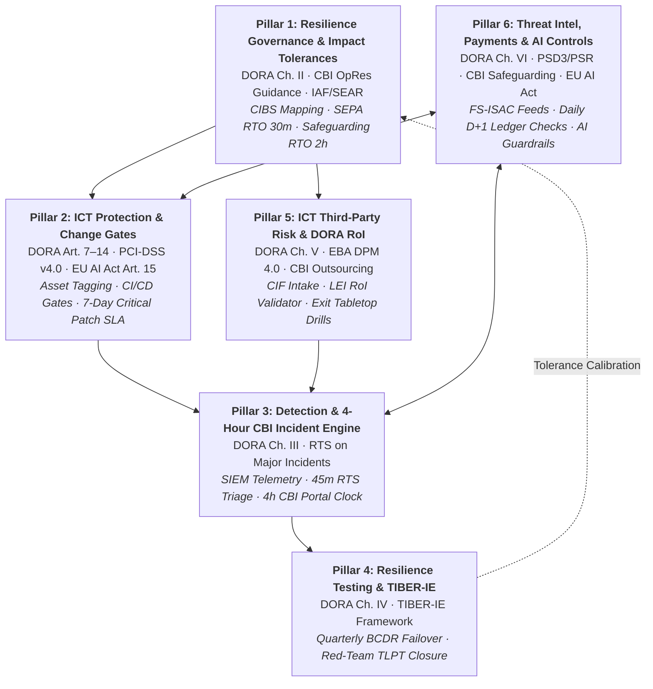

# Irish Regulated Payment Institution (PI/EMI)
### 6-Pillar Digital Operational Resilience, Payment Security & AI Governance Operating System

An executive reference architecture demonstrating how a **Central Bank of Ireland (CBI)–authorised Payment Institution** operationalises **DORA (Chapters II–VI)**, **CBI Cross-Industry Operational Resilience Guidance**, **PSD2/PSD3 re-authorisation**, **PCI-DSS v4.0**, and the **EU AI Act / Regulation of Artificial Intelligence Act 2026** across real-time SEPA Instant and card acquiring workflows.

Built from a **Head of Security / Head of ICT & InfoSec Risk** perspective, this repository moves beyond static policy summaries—pairing **closed-loop operational workflows, decision gates, and RACI matrices** with **formula-driven Excel operational registers and executive KRI dashboards**.

---

## 1. Closed-Loop Digital Operational Resilience Architecture

---

## 2. The 6-Pillar Operating Matrix (Processes, Outcomes & Excel Registers)

| Pillar & Process Guide | Regulatory Anchor | Defined End-to-End Process & Gates | Result-Oriented Target Outcomes | Operational Excel Register (`.xlsx`) |
| :--- | :--- | :--- | :--- | :--- |
| **[Pillar 1: Resilience Governance & Impact Tolerances](pillar-01-governance-and-impact-tolerances/README.md)** | **DORA Ch. II (Art. 5–6)**, **CBI OpRes Guidance**, & **CBI IAF / SEAR** | External CIBS vs. CIF triage → Dependency mapping → Board Impact Tolerance setting → 90-day Risk Exception Gate. | • SEPA Instant RTO `< 30m` (RPO `0` txn loss) • `100%` of risk exceptions tied to PCF owner & 90d expiry | [`pillar-01-cibs-impact-tolerances.xlsx`](pillar-01-governance-and-impact-tolerances/pillar-01-cibs-impact-tolerances.xlsx) |
| **[Pillar 2: ICT Protection & Change Control](pillar-02-ict-protection-and-change-control/README.md)** | **DORA Ch. II (Art. 7–14)**, **PCI-DSS v4.0**, & **EU AI Act Art. 15** | Asset-to-CIBS tagging → Pre-release CI/CD & AI-egress gates → CVSS/KEV triage → Patch SLA & virtual patch enforcement. | • Critical (`CVSS >= 9.0`) patched `< 7d` (`>= 95%` SLA) • `0` unapproved releases bypassing rollback/DLP checks | [`pillar-02-ict-asset-vuln-sla-tracker.xlsx`](pillar-02-ict-protection-and-change-control/pillar-02-ict-asset-vuln-sla-tracker.xlsx) |
| **[Pillar 3: Incident Response & CBI 4-Hour Clock](pillar-03-incident-response-and-cbi-reporting/README.md)** | **DORA Ch. III (Art. 17–23)** & **DORA RTS on Major Incidents** | Alert trigger → 30m technical triage → 45m quantitative RTS threshold gate → CBI Portal initial (`< 4h`), `72h`, & `30d` RCA. | • Mean Time to Classify (MTTC) `< 45 mins` • `100%` on-time CBI statutory portal submissions | [`pillar-03-dora-incident-cbi-clock.xlsx`](pillar-03-incident-response-and-cbi-reporting/pillar-03-dora-incident-cbi-clock.xlsx) |
| **[Pillar 4: Resilience Testing & TIBER-IE](pillar-04-resilience-testing-and-tiber-ie/README.md)** | **DORA Ch. IV (Art. 24–27)** & **TIBER-IE Framework** | Annual risk-based test plan → Quarterly BCDR failover drills → **TIBER-IE** red-team scoping, purple-team replay & closure gate. | • Failover recovery `<= 75%` of Impact Tolerance • `100%` of TIBER-IE critical/high findings closed `< 60d` | [`pillar-04-resilience-testing-tiber-ie.xlsx`](pillar-04-resilience-testing-and-tiber-ie/pillar-04-resilience-testing-tiber-ie.xlsx) |
| **[Pillar 5: Third-Party Risk & DORA RoI](pillar-05-third-party-risk-and-dora-roi/README.md)** | **DORA Ch. V (Art. 28–44)**, **EBA DPM 4.0**, & **CBI Outsourcing** | Intake & CIF triage → Art. 30 contractual gate → EBA RoI LEI validation → Concentration scoring → Annual stressed exit drill. | • Onboarding SLA reduced from `25d` to `<= 7d` • `0` EBA/CBI Portal LEI or parent validation errors | [`pillar-05-dora-roi-and-vendor-exit.xlsx`](pillar-05-third-party-risk-and-dora-roi/pillar-05-dora-roi-and-vendor-exit.xlsx) |
| **[Pillar 6: Threat Intel, Payments & AI Controls](pillar-06-threat-intel-payments-and-ai/README.md)** | **DORA Ch. VI**, **PSD3 / PSR**, **CBI Safeguarding**, & **EU AI Act** | Threat feed ingestion → Daily `D+1` safeguarding reconciliation → Verification of Payee (VoP) logging → AI Annex III & Art. 50 guardrails. | • `0` unresolved safeguarding breaks `> €0.01` past `T+1` • Fraud AI human override `< 15m` (`>= 98%` SLA) | [`pillar-06-safeguarding-psd3-ai-register.xlsx`](pillar-06-threat-intel-payments-and-ai/pillar-06-safeguarding-psd3-ai-register.xlsx) |

---

## 3. Executive Outcome Scorecard (Board Risk Appetite Benchmarks)

| Governance Dimension | Baseline (Legacy / Manual) | Target Operating State | Supervisory / Audit Proof |
| :--- | :--- | :--- | :--- |
| **CBI DORA Register of Information (RoI)** | Ad-hoc vendor spreadsheets with high risk of LEI/parent errors during March CBI Portal window | Standardized RoI master register with automated 20-char LEI validation (`0` EBA rejections) | Annual **CBI Portal XBRL Return** & **CBI ICT-SAT** evidence pack |
| **Safeguarding Account Integrity (PCF-56)** | End-of-month manual bank statement checks; risk of single-bank concentration | Daily `D+1` reconciliation log enforcing `<= €0.01` break threshold & `<= 50%` single-bank cap | Daily immutable reconciliation logs & annual **ISAE 3000** assurance report |
| **Major ICT Incident Classification** | Subjective severity calls risking breach of DORA's 4-hour initial CBI reporting clock | Formula-driven EU RTS threshold calculator computing exact `4h / 72h` CBI deadlines | Timestamped triage logs & CBI Portal submission receipts |
| **Enterprise AI & Shadow AI Governance** | Uninventoried SaaS AI features; unclear Annex III credit vs. fraud classification | Central AI Inventory mapped to **Regulation of AI Act 2026**, **Art. 50** disclosures & human override SLAs | **CBI Market Surveillance** readiness pack & override audit trail |

---

## 4. Industry Reference Frameworks & Community Benchmarks
* **Supervisory & Technical Standards:** Central Bank of Ireland **ICT Self-Assessment Tool (ICT-SAT)**, **TIBER-IE** Threat-Led Penetration Testing Framework, **EBA DORA RoI Data Point Model (DPM 4.0)**, and Ireland's **Regulation of Artificial Intelligence Act 2026** (*Oifig IS na hÉireann*).

