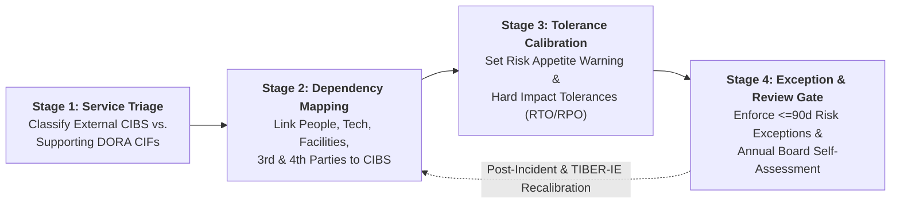

# Pillar 1: Resilience Governance, Business Service Mapping & Impact Tolerances
**Regulatory Anchor:** DORA Chapter II (Articles 5–6) · CBI Cross-Industry Guidance on Operational Resilience (Revised July 2025) · CBI Individual Accountability Framework (IAF / SEAR)

---

## 1. Regulatory Design Principles (CBI & DORA Alignment)
Under the Central Bank of Ireland's revised **Cross-Industry Guidance on Operational Resilience** and **DORA Chapter II**, governance enforces three explicit boundaries:
1. **External CIBS vs. Internal CIFs:** Under CBI OpRes Guidance (Guideline 4), **Critical or Important Business Services (CIBS)** are strictly *external-facing* services delivered to an identifiable end user (e.g., SEPA Instant payment execution). Internal platforms and processes supporting those services (e.g., Core Ledger, KMS, Cloud Hosting) are mapped as **Critical or Important Functions (CIFs)** under DORA.
2. **Risk Appetite vs. Impact Tolerance:** **Risk Appetite** defines the internal operational threshold where 1st/2nd Line intervention triggers (early warning). **Impact Tolerance** defines the absolute maximum level of disruption beyond which irrecoverable harm occurs to customers, the firm, or Irish/EU financial stability—breaching an Impact Tolerance means Risk Appetite has already been breached.
3. **Board Annual Self-Assessment:** Under CBI OpRes Guideline 1 and DORA Article 5, the Board Risk Committee reviews and approves a documented **Operational Resilience Self-Assessment** and ICT Risk Framework annually.

---

## 2. End-to-End Operational Process & Decision Gates

### Mandatory Hard Gates
* **Gate 1 (New Product / Feature Launch):** No new payment rail, card product, or customer-facing API can launch in production until mapped to an existing or newly Board-approved CIBS with defined Impact Tolerances.
* **Gate 2 (Single-Point-of-Failure Block):** Any CIBS dependency map revealing an unmitigated single point of failure (SPOF) across cloud availability zones, HSM clusters, or safeguarding banks automatically triggers a mandatory remediation plan or formal Board-level Risk Acceptance.
* **Gate 3 (Time-Bound Risk Acceptance):** 1st Line Engineering cannot silently defer resilience gaps. Every exception requires documented compensating controls, a maximum expiry of **90 calendar days**, and dual sign-off by the **Head of ICT & InfoSec Risk** and accountable **PCF**.

---

## 3. RACI & CBI Accountability Matrix

| Governance Activity | Board Risk Committee (PCF-3/5) | CEO (PCF-1/8) | CTO (1st Line Tech) | Head of ICT Risk (2nd Line) | PCF-56 (Safeguarding) | MLRO (PCF-52) |
| :--- | :---: | :---: | :---: | :---: | :---: | :---: |
| **CIBS Criteria & Impact Tolerance Approval** | **A** | **R** | **C** | **R** | **C** | **C** |
| **End-to-End Tech & Cloud Dependency Mapping** | **I** | **I** | **R** | **A / Challenge** | **C** | **C** |
| **Safeguarding Ledger Tolerance & Reconciliation SLAs** | **I** | **A** | **R** | **C** | **R** | **I** |
| **Risk Exception Sign-Off (Medium Residual Risk)** | **I** | **I** | **R** | **A** | **C** | **C** |
| **Risk Exception Sign-Off (High Residual Risk)** | **A** | **C** | **R** | **R** | **C** | **C** |
| **Annual CBI OpRes Self-Assessment & DORA Art. 5 Review** | **A** | **R** | **C** | **R** | **C** | **C** |

*(**R** = Responsible, **A** = Accountable, **C** = Consulted, **I** = Informed)*

---

## 4. Result-Oriented Impact Tolerance & Governance Matrix

| CIBS ID | External-Facing Business Service (CIBS) | Supporting DORA CIFs | Risk Appetite (Amber Trigger) | Hard Impact Tolerance (Red Breach) | RPO (Data Loss) | Target Governance Outcome |
| :--- | :--- | :--- | :--- | :--- | :--- | :--- |
| **CIBS-01** | **SEPA Instant Credit Transfers (24/7/365)** | Core Ledger, API Gateway, VoP Engine, Fraud AI (`AI-001`), AWS `eu-west-1` | `> 10 mins` degraded settlement (`> 10s` p99 latency) | **`30 minutes`** full outage | **`0` transactions** (Synchronous multi-AZ commit) | `>= 99.98%` availability; `100%` of quarterly failover drills `< 22 mins` (`<= 75%` tolerance) |
| **CIBS-02** | **Card Issuing & Point-of-Sale Authorization** | Token Vault, Cloud HSM (`ICT-2026-003`), Scheme Gateway | `> 15 mins` authorization decline spike (`> 0.5%` error rate) | **`45 minutes`** full outage | **`0` transactions** | Zero unscheduled CDE outages; dual-region HSM quorum failover `< 15 mins` |
| **CIBS-03** | **Customer Fund Safeguarding & Daily Reconciliation** | Safeguarding Sub-Ledger, ISO 20022 `camt.053` Ingestion, Treasury Sweep | Any sweep delay `> 2 hours` past `D+1` cutoff | **`4 hours`** reconciliation outage | **`0.00 EUR` variance** | `100%` daily `D+1` segregation; `0` unresolved breaks `> €0.01` for ISAE 3000 audit |
| **CIBS-04** | **Customer Onboarding & eKYC Verification** | Biometric Liveness API (`AI-004`), Sanctions Screening, Mobile App | `> 1 hour` onboarding queue backlog | **`4 hours`** service unavailability | **`< 5 minutes`** session state | Automated fallback to manual compliance review within `30 mins` of API outage |

---

## 5. Operational Excel Register & Executive Dashboard
The live dependency mappings, Board Impact Tolerance thresholds, and active 90-day risk exceptions governing these services are maintained in [`pillar-01-cibs-impact-tolerances.xlsx`](pillar-01-cibs-impact-tolerances.xlsx), which includes:
* **`Executive_Summary` Tab:** Automated KPI cards and a clustered column chart benchmarking Board Impact Tolerances against actual failover recovery times.
* **`CIBS_Dependency_Matrix` Tab:** End-to-end mapping of external CIBS (`CIBS-01` to `CIBS-05`) to supporting DORA CIFs, cloud regions, PCF owners, and automated tolerance margin formulas.
* **`Risk_Exception_Register` Tab:** Time-bound 90-day exception log with automated expiry countdowns (`=Expiry_Date - TODAY()`) and Board escalation triggers.
